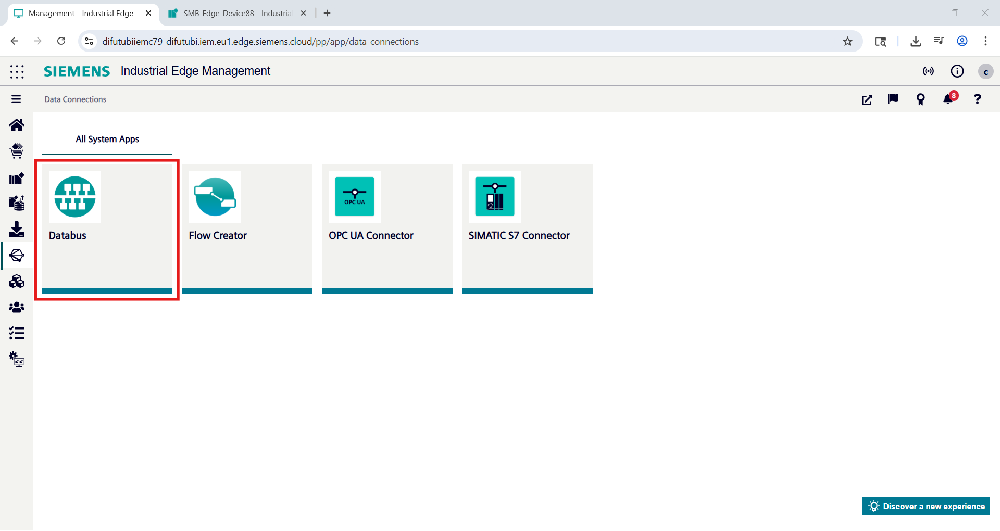
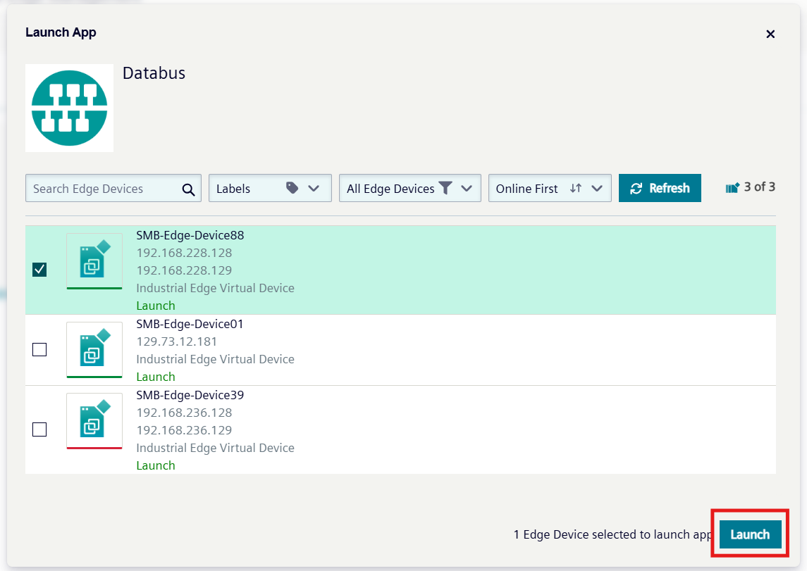
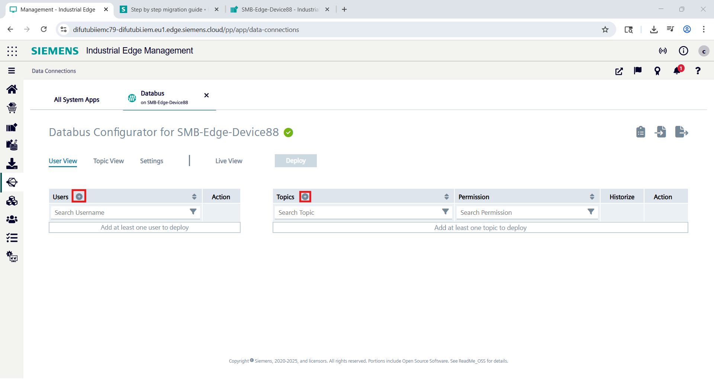
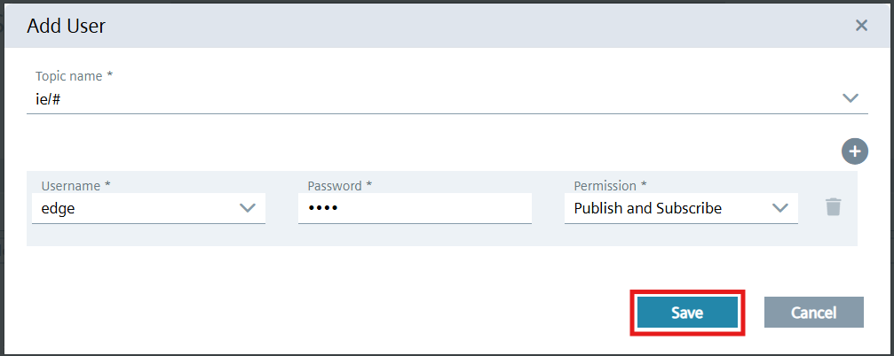
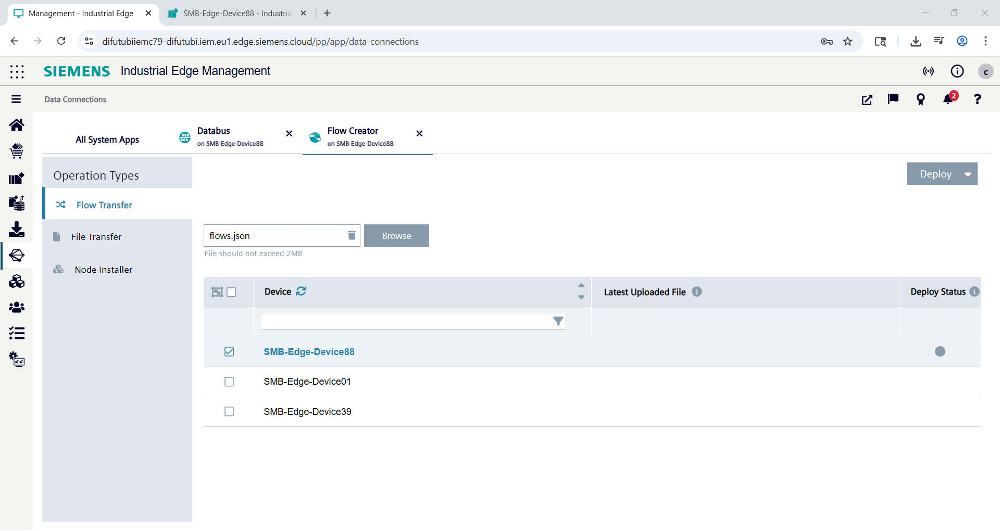
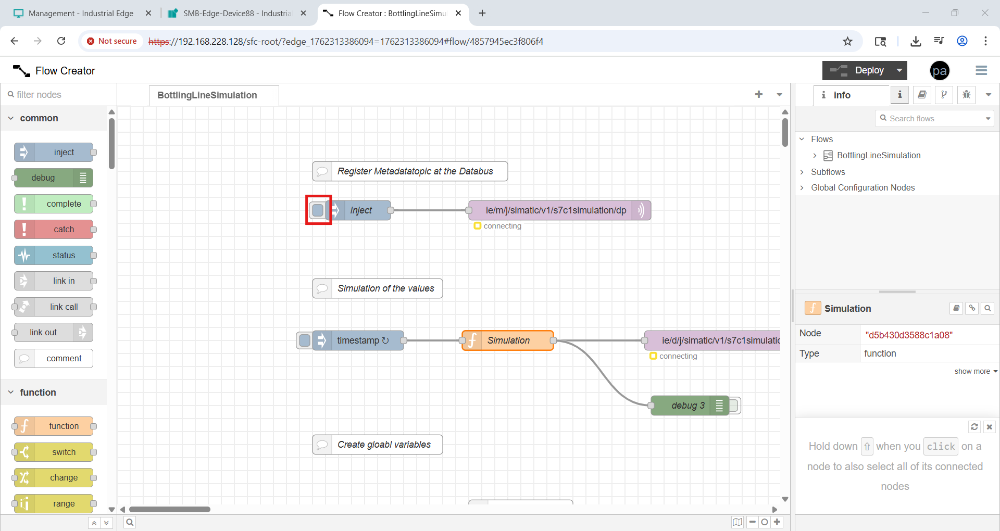
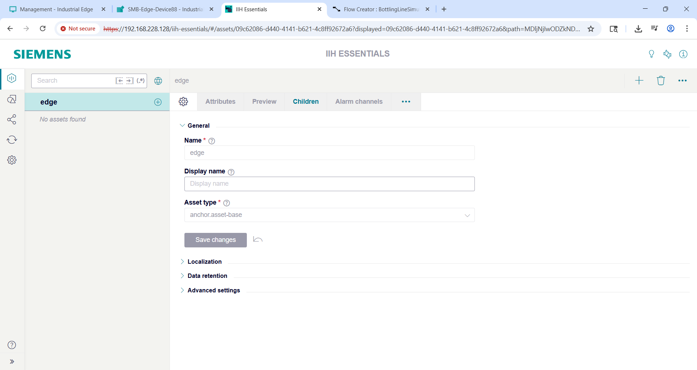
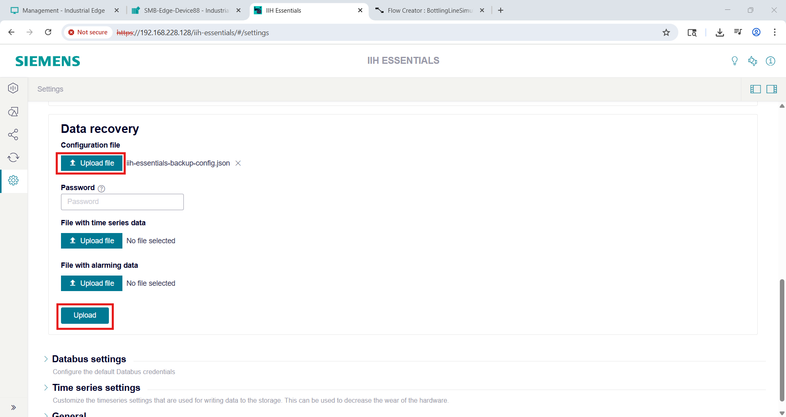
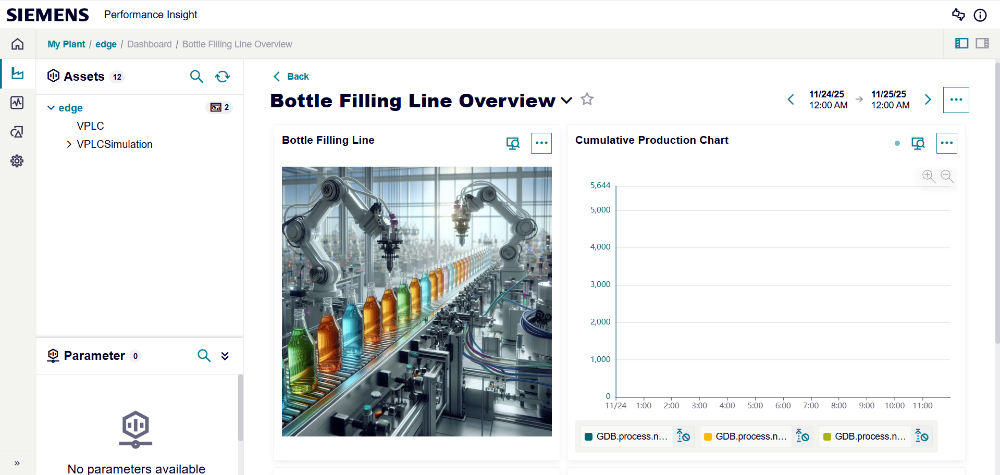

# Bottle Filling Demo - FlowCreator

## Table of Contents

- [1. Introduction](#1-introduction)
- [2. Prerequisites](#2-prerequisites)
  - [2.1. Environment](#21-environment)
  - [2.2. Required Apps](#22-required-apps)
  - [2.3. Required Files](#23-required-files)
- [3. Configure Applications](#3-configure-applications)
  - [3.1. Configure Databus](#31-configure-databus)
  - [3.2. Configure FlowCreator](#32-configure-flowcreator)
  - [3.3. Configure IIH Essentials](#33-configure-iih-essentials)
- [4. Result](#4-result)
- [5. Contribution](#5-contribution)
- [6. Licence and Legal Information](#6-licence-and-legal-information)

## 1. Introduction

This app is a demonstrator that shows what data you could present via **Industrial Edge** for a bottle filling production system. For this purpose, it emulates the bottle filling station and the data it could provide.

## 2. Prerequisites

### 2.1. Environment

- Setting up a working Industrial Edge Hub / Industrial Edge Management / Industrial Edge (Virtual) Device environment (out of scope for this tutorial)
- Installing all [required apps](#22-required-apps) on the Industrial Edge (Virtual) Device (out of scope for this tutorial)

### 2.2. Required Apps
- **Flow Creator** (**v1.18** or newer)
- **Databus** (**v3.0.2** or newer)
- **IIH Essentials** (**v2.0.0** or newer)
- **Performance Insight** (**v1.18.1** or newer)
- **Energy Manager** (**v1.18** or newer)

### 2.3. Required Files
- [flows.json](./src/flows.json) - Contains the Node-RED code to be deployed in **FlowCreator**. It simulates a bottle filling line and sends emulated production data to the **Databus**.
- [iih-essentials-backup-config.json](./src/iih-essentials-backup-config.json) - IIH Essentials configuration file that contains the configuration data for setting up the data points in IIH Essentials
- [Bottle_Filling_Line_Overview.json](./src/Bottle_Filling_Line_Overview.json) - Performans Insight Overview Dashboard
- [Bottle_Filling_Line_State_Flow.json](./src/Bottle_Filling_Line_State_Flow.json) - Performance Insight State Dashboard

## 3. Configure Applications

We have to configure the applications so that they can work together. We need to achieve the following:

 - Databus is configured to provide a topic `ie/#` with username and password for read/write access.
 - FlowCreator needs to be configured by loading [script files](./src/flows.json).
 - IIH Essentials needs to be loaded with the configuration for the Bottling Line Demo app (data points). The project comes with a [configuration file](./src/iih-essentials-backup-config.json) to use for this.
 - Performance Insight needs to be configured to use [Overview](./src/Bottle_Filling_Line_Overview.json) and [State](./src/Bottle_Filling_Line_State_Flow.json) dashboards.

### 3.1. Configure Databus

We have to configure the **Databus** to handle a topic group `ie/#`. Note that the `#` is a placeholder symbol. We configure the **Databus** for any topic that starts with `ie/`. This is done from the IEM via the "**Data Connections**" tab.

*Step 1: Click the **Databus** icon*

*Step 2: Select the Edge Device and click the **Launch** button*

*Step 3: Click the Users `(+)` button*

On the next page, add a new user with `edge` as *username* and *password* (both the same). Then create a topic `ie/#` with **Publish and Subscribe** permissions for the user "**edge**".

**Username:** `edge`
**Password:** `edge`
**Topic name:** `ie/#`
**Permission:** `Publish and Subscribe`

*Step 4: Save username, password, and topic*

### 3.2. Configure FlowCreator

In this step we import the **FlowCreator** script that simulates the data of a bottling production
line. It is basically a Node-RED workflow. For this, navigate to the "**Data Connections**" tab in IEM and select the **FlowCreator** app.

From the **Flow Transfer** tab, **Browse** and select the [flows.json](./src/flows.json) file, then select the Edge Device and click the **Deploy** button.

*Step 1: Deploy [flows.json](./src/flows.json) file*

After having deployed the flow, we have to make sure that the **Databus** connection is set up correctly. This is done by injecting a simulation *datapoint* and a *timestamp* by clicking on the corresponding buttons in the flow. The connected `MQTT` output nodes should show a green "**connected**" flag:

*Step 2: Verify Databus connection*

If the *green light* does not show up double click on the `MQTT output nodes` and make sure that they
are configured correctly with the *username* and *password* of the databus user `edge` which we
configured in the [previous section 3.1.](#31-configure-databus).

> [!note]
> Note that the core logic for creating the data is implemented within the function "Simulation". Feel free to open the function and review the `JavaScript` code.

### 3.3. Configure IIH Essentials

The IIH Essentials app must be configured to read the datapoints from the MQTT topics which we configured in the
Databus (see [Section 3.1.](#31-configure-databus)).

*Step 1: Open IIH Essentials app from your Edge Device*

Click on **Settings** and open the group **Backup and restore**:

*Step 2: IIH Essentials Backup and Restore*

Select the [iih-essentials-backup-config.json](./src/iih-essentials-backup-config.json) file and click the **Upload** button.

> [!note]
> If you have other assets configured in your IIH Essentials which you do not need, we suggest to delete them (for example, there could be a default vPLC asset).

## 4. Result
Now open the Performance Insight app to see the result:

*Congratulations! :party_popper:*

## 5. Contribution

Thank you for your interest in contributing. Anybody is free to report bugs, unclear documentation, and other problems regarding this repository in the Issues section.
Additionally everybody is free to propose any changes to this repository using Pull Requests.

If you haven't previously signed the [Siemens Contributor License Agreement](https://cla-assistant.io/industrial-edge/) (CLA), the system will automatically prompt you to do so when you submit your Pull Request. This can be conveniently done through the CLA Assistant's online platform. Once the CLA is signed, your Pull Request will automatically be cleared and made ready for merging if all other test stages succeed.

## 6. Licence and Legal Information

Please read the [Legal information](LICENSE.md).
